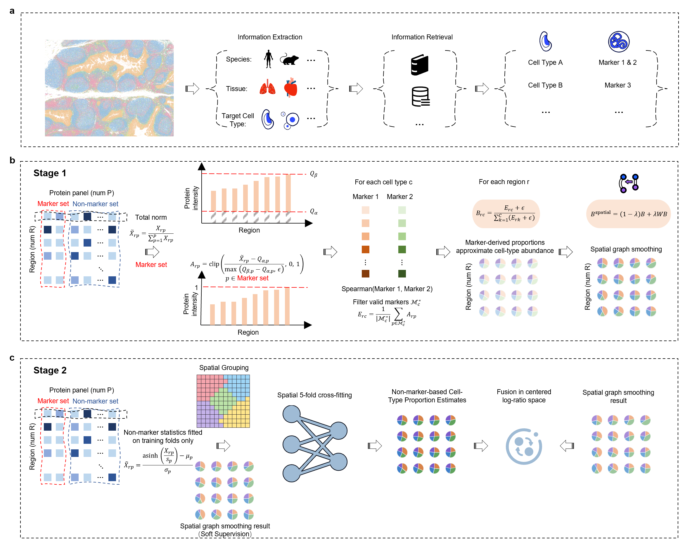

# AnchorDECODE

```text
    _     _   _   ____  _   _   ___   ____   ____   _____   ____   ___   ____   _____
   / \   | \ | | / ___|| | | | / _ \ |  _ \ |  _ \ | ____| / ___| / _ \ |  _ \ | ____|
  / _ \  |  \| || |    | |_| || | | || |_) || | | ||  _|  | |    | | | || | | ||  _|
 / ___ \ | |\  || |___ |  _  || |_| ||  _ < | |_| || |___ | |___ | |_| || |_| || |___
/_/   \_\|_| \_| \____||_| |_| \___/ |_| \_\|____/ |_____| \____| \___/ |____/ |_____|
```

### Marker-guided, reference-free deconvolution of spatial proteomics

AnchorDECODE estimates cell-type proportions from spatial protein measurements, tissue coordinates, and literature-supported protein markers. It combines a spatially calibrated marker estimate with a neural ensemble trained on non-marker proteins. No labeled single-cell reference or measured cell-type proportions are required for fitting.



## Repository structure

```text
AnchorDECODE/
├── model/AnchorDECODE.py          # Standalone model implementation
├── examples/spots.py              # Runnable SPOTS example and data reader
├── examples/spots_markers.json    # Marker definitions for the example
├── tutorials/SPOTS_tutorial.ipynb # Step-by-step notebook for the same example
├── docs/tutorial.md               # Installation, workflow, and your own data
├── fig/Fig1.png                   # Method overview
├── requirements.txt              # General dependencies
├── requirements-gpu.txt          # PyTorch 2.11.0 with CUDA 12.8
└── environment.yml
```

## Installation

Download or clone this repository, open a terminal in its root directory, and create the NVIDIA GPU environment (Linux or Windows):

```bash
conda env create -f environment.yml
conda activate anchordecode
```

Alternatively, in a Python 3.11 environment:

```bash
python -m pip install -r requirements-gpu.txt
python -m pip install jupyterlab
```

Both installation routes explicitly select **PyTorch 2.11.0 + CUDA 12.8** from the [official PyTorch wheel repository](https://pytorch.org/get-started/previous-versions/#v2110). An NVIDIA GPU and a compatible NVIDIA driver are required for CUDA execution. Check the installation before running:

```bash
python -c "import torch; print(torch.__version__, torch.version.cuda); print('CUDA available:', torch.cuda.is_available())"
```

Expect a CUDA build version ending in `+cu128`, CUDA runtime `12.8`, and `CUDA available: True`. Installing the GPU build and selecting the runtime device are separate steps: the example commands below pass `--device cuda`. The core model's default device remains CPU. See the [tutorial](docs/tutorial.md#1-install) for a CPU-only installation.

## Example: SPOTS mouse spleen

The example analyzes spleen replicate 1 from the SPOTS study ([paper](https://doi.org/10.1038/s41587-022-01536-3); [GEO GSE198353](https://www.ncbi.nlm.nih.gov/geo/query/acc.cgi?acc=GSE198353)). It uses 2,653 tissue spots and 21 antibody features to estimate five cell populations: B cells, T cells, red pulp macrophages, CD169+ macrophages, and neutrophils.

Download these two files and place them in `data/SPOTS/`. **Data are not included in this repository.**

| File | Download |
| --- | --- |
| `GSE198353_spleen_rep_1_filtered_feature_bc_matrix.h5` | [Protein and RNA counts](https://ftp.ncbi.nlm.nih.gov/geo/series/GSE198nnn/GSE198353/suppl/GSE198353_spleen_rep_1_filtered_feature_bc_matrix.h5) |
| `GSE198353_spleen_replicate_1_spatial.tar.gz` | [Spatial coordinates and images](https://ftp.ncbi.nlm.nih.gov/geo/series/GSE198nnn/GSE198353/suppl/GSE198353_spleen_replicate_1_spatial.tar.gz) |

Keep the spatial archive compressed. Then run:

```bash
python examples/spots.py --data-dir data/SPOTS --out results/SPOTS --device cuda
```

The script selects the antibody features, aligns spatial coordinates by barcode, fits AnchorDECODE, and saves `prediction.csv`, `model.pt`, and `proportions.png`, together with intermediate estimates and model settings. The main prediction table has one row per spot and one column per cell type; each row sums to one.

For an interactive walkthrough, launch `jupyter lab` from the repository root and open [SPOTS_tutorial.ipynb](tutorials/SPOTS_tutorial.ipynb). Read the [complete tutorial](docs/tutorial.md) for input formats, parameter settings, output descriptions, and analysis of your own tissue section.

## Python interface

Run from the repository root:

```python
from model import AnchorDECODE

# expression: pandas DataFrame, spots × proteins, raw nonnegative values
# coords: pandas DataFrame, the same spot index/order, columns x and y
# markers: {cell_type: [protein_name, ...]}
model = AnchorDECODE(device="cuda")
result = model.train(expression, coords, markers)
proportions = result["prediction"]
model.export("results/my_sample")
```

Fit each tissue section independently. Use the full measured protein panel, with marker names matching its column identifiers. Input values should be raw counts or nonnegative intensities; the model performs its own preprocessing. The fitted model's `predict()` method replays predictions for the original fitted section. Fit a new model for a new section.

## Reproducibility

The example uses the experimental defaults: five spatial folds, three seeds (42, 43, 44), 180 training epochs per network, and fusion weight 0.5. This gives an ensemble of 15 networks. All defaults are listed in the [tutorial](docs/tutorial.md#model-settings), and each run exports its settings in `parameters.json`.

The model is copied unchanged from the research implementation. The example uses raw deposited protein counts and the same marker definitions as the SPOTS experiment. Spatial folds apply to neural training; the marker estimate is calibrated using the whole target section. Results can vary across software versions and hardware.

Both the command-line example and all notebook cells were validated on CPU with Python 3.11.16, NumPy 2.4.6, pandas 2.3.3, SciPy 1.17.1, scikit-learn 1.9.1, PyTorch 2.11.0, h5py 3.16.0, and matplotlib 3.11.2. Validation covered full default training, proportion normalization, plotting, and checkpoint reload. The example reader reproduced the experimental input counts and coordinates exactly, and predictions agreed with the existing SPOTS analysis within numerical precision.

## Data citation

For the example data, cite *Integration of whole transcriptome spatial profiling with protein markers*, Nature Biotechnology (2023), [DOI: 10.1038/s41587-022-01536-3](https://doi.org/10.1038/s41587-022-01536-3), [PMID: 36593397](https://pubmed.ncbi.nlm.nih.gov/36593397/). Marker sources are listed in the [tutorial](docs/tutorial.md#marker-definitions).
